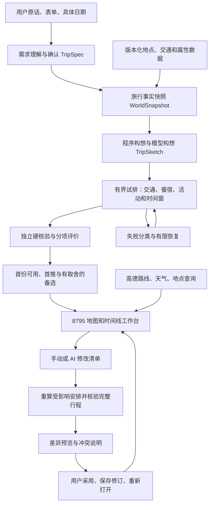

# ShortTrip 当前项目完整介绍

核对日期：2026-11-23。介绍对象为 `ShortTrip-Fusion-Dev` 中的 8795 统一工作台、8781 个性化规划服务及其依赖。本文依据当前源码和已保存的实验报告整理。本次没有重新运行 30 条需求或重新测量模型性能。

部分 README 和 ARCHITECTURE.md 停留在较早阶段，例如仍列出“旅行灵感”、旧版搜索预算或把 AI 修改列为后续工作。本文以当前入口、调用链和较新的验收记录为准。当前功能、实验工具和待实现能力分别说明。

## 1. 项目定位与用户价值

ShortTrip 是面向国内旅行的个性化行程规划与调整工作台。用户提供出发地、目的地、日期、人数、预算和旅行要求，系统把需求转成可核验的结构，结合地点和交通数据产生完整行程，在地图和逐日时间线上展示，并支持比较、修改、采用、保存和重新打开。

一份完整行程包含往返交通、每日景点、用餐、住宿和活动之间的接驳。项目的技术重点是把语言理解、约束规划、体验评价和交互修改连接起来，让用户能判断行程为什么这样安排，以及改变一项安排会付出什么代价。

项目当前价值可以概括为五点：

1. **要求有记录。** 原话、表单、硬条件、软偏好和待确认项一起保留。
2. **行程有核验。** 从成品重新检查费用、时间、地点、交通和明确条件。
3. **选择有依据。** 比较具体费用、接驳、步行、游览和偏好差异。
4. **修改有反馈。** 预览受影响的安排，保护预约和返程，核验后再采用。
5. **问题可复查。** 保存数据版本、候选、模型记录、阶段耗时、错误与实验报告。

当前适合描述为可本地部署的旅行助手和研究原型。用户满意度、真实出行采用率和大规模公共服务稳定性尚未得到充分验证。

## 2. 当前范围与部署组成

| 项目 | 当前状态 |
|---|---|
| 用户入口 | 8795 统一工作台 |
| 规划服务 | 本机 8781，由工作台转接 |
| 新规划开放城市 | 北京、上海、南京、苏州、杭州、深圳、成都、武汉、广州、重庆 |
| 数据安装 | V20 十二城包，西安和厦门保留查询与历史复查数据，暂不开放新规划 |
| 主要规划协议 | 一个出发城市到一个目的地的往返旅行 |
| 天数 | 接受正整数，没有强制 1–3 天限制；较长行程能否排出仍受数据和预算限制 |
| 模型方式 | 云端 DeepSeek Flash、本地 Qwen、表单/程序模式；实际可用性取决于服务配置 |
| 用户组织方式 | 单人管理旅行，可填写同行人数；没有多人协同编辑产品 |
| 商业预订 | 参考价、官方核对入口、用户自标已预订；没有接入酒店门票合作库存和支付下单 |

源码分布：

| 目录 | 职责 |
|---|---|
| `shorttrip-webui/shorttrip-webui/webui` | 工作台、地图、路线与在线事实接口、修改桥接 |
| `combined version_personalized/chinatravel/personalization` | 需求、个性化、事实快照、构想、试排调度、评价、恢复和修改 |
| `ShortTrip/chinatravel/planning` | 当前复用的有界构造器、快照约束和独立核验 |
| `ShortTrip/artifacts/data` | 固定版本旅行数据 |
| `datasets` | 基准需求与其他题集 |
| `combined version_personalized/result` | 当前需求修订、任务、预览、反馈和实验产物 |
| `ShortTrip/finetuning`、`experiments` | 训练、旧算法与独立评测资产 |

启动时在 `ShortTrip-Fusion-Dev` 目录运行：

```powershell
& './shorttrip-webui/shorttrip-webui/Start-ShortTrip.ps1'
```

打开 [新建旅行](http://127.0.0.1:8795/?new=1)。启动器检查依赖、端口和归档，启动工作台与规划器并进行连通检查。模型密钥由后端环境或本机受保护配置读取；高德配置也在后端读取。

## 3. 整体架构与信息流



一次需求有需求编号和修订号，事实快照有版本与标识，每份候选有自己的编号，编辑预览记录原方案和父版本。模块之间检查这些关联，避免用旧需求修改新行程、用不同快照的价格评价同一方案，或者将过期修改误应用到另一个候选。

大模型参与需求和修改意图理解、整趟地点构想；程序承担交通、时间窗、费用、硬条件核验和结果保存。当前网上补查和离线规划事实是两类证据，页面不能把后查路线的时长直接当作原方案已经采用的新安排。

## 4. 模块总表

| 模块 | 用户问题 | 核心产物 | 当前归属 |
|---|---|---|---|
| 需求理解与确认 | 系统是否听懂我的要求 | TripSpec、原文证据、冲突项 | 主流程 |
| 个性化与属性映射 | 喜好是否影响具体安排 | 地点匹配、构想偏好、偏好兑现记录 | 主流程 |
| 数据建设与版本管理 | 规划依据从哪里来 | 城市数据、属性目录、来源和固定版本 | 主流程及数据工程 |
| 旅行事实层 | 不同模块是否使用同一个地点和价格 | WorldSnapshot | 主流程 |
| 行程构想 | 哪些地方适合一起、分哪天去 | TripSketch | 主流程 |
| 完整试排与搜索调度 | 能否在有限时间内拼成可走的旅行 | 完整候选池、首份结果 | 主流程 |
| 独立核验 | 成品是否满足明确要求 | validation_report、硬条件逐项结果 | 主流程 |
| 体验、偏好和方案比较 | 哪个方案更适合我 | 质量向量、差值、首推和备选 | 主流程及独立研究工具 |
| 失败恢复与经验 | 排不出时怎么办 | 原因、条件方案、待确认项、错误记录 | 主流程 |
| 可视化工作台 | 能否看懂整趟安排 | 时间线、地点详情、地图联动 | 主流程 |
| 地图与路线 | 地点间怎样走 | 路线几何、交通详情、高德入口 | 主流程 |
| 天气、营业与关键接驳补查 | 出发前还有什么需要确认 | 日期相关事实与风险提醒 | 主流程的辅助查询 |
| 手动编辑与顺路优化 | 能否自主修改 | 已核验编辑预览及新版本 | 主流程 |
| AI 行程修改 | 能否用一句话调整多项安排 | 操作清单、追问、统一试排结果 | 主流程，范围有限 |
| 保存、恢复与预订核对 | 改完后怎么保存、怎么准备出行 | 可重开链接、修订记录、核对清单 | 主流程 |
| 模型接入与本地微调 | 模型怎样使用和替换 | 统一 JSON 接口、本地推理适配、LoRA 实验 | 主流程及历史研究 |
| 实验、用户反馈与运行维护 | 如何证明有效、如何定位失败 | 回归报告、耗时记录、盲选和任务测试 | 工程与研究支撑 |

## 5. 需求理解与确认

### 输入和表示

用户可以同时用表单和自然语言表达要求。8795 在提交规划前要求填写具体出发日期。

TripSpec 中每项要求保存字段、值、运算符、单位、作用范围、强度和来源证据。例如同样是“预算 8000 元”，还需要分辨是整团还是人均、包含整趟还是排除往返交通。预约需要地点、日序、开始时刻和时长，不能只保留“有预约”三个字。

主要可表达内容包括：

- 出发地、目的地、旅行天数、人数和日期。
- 整团或人均预算、每餐预算、住宿预算、房间数量和住宿晚数。
- 往返交通及其去返程作用范围、市内交通方式。
- 必去、排除、偏好地点，已确认预约。
- 景点兴趣、菜系、酒店设施、旅行节奏、少走路或少接驳等目标。
- 同行背景、旅行背景及暂时无法执行的描述。

字段存在不代表全部都已实现相同强度的规划支持。例如“安静”“适合轮椅”“全日步行很轻松”可能可以记录，但数据不足以完整判断，必须保留待确认或证据不足状态。

### 处理过程

模型返回受约束的 JSON。程序检查字段和值、原文引文、数字单位和作用范围，合并表单与文本，发现冲突后交给用户选择。确认或修改产生新修订，后续规划绑定该修订。

TripSpec 与旧 DSL 有不同职责。TripSpec 是当前工作台的需求协议，能表达来源和不确定性；旧 DSL 与编译器保留了可执行约束模板和历史对照接口。当前主链路通过 `constructor_input` 将可执行项适配给构造器，独立核验再按确认需求检查，不能把“模型成功输出 DSL”当作最终正确性证明。

代码入口：[tripspec.py](../chinatravel/personalization/tripspec.py)、[planning_compat.py](../chinatravel/personalization/planning_compat.py)、[compiler.py](../chinatravel/personalization/compiler.py)。

## 6. 个性化模块

当前个性化主要来自本次明确表达和用户点选，尚未建立跨旅行、长期自动学习的个人画像。

偏好在三个位置生效：

1. **候选检索。** 将“博物馆”“本帮菜”“行李寄存”等映射到当前城市实际存在的景点类别、菜系和酒店属性。
2. **构想与试排。** 影响每天的核心景点、餐馆候选、活动区域和住宿方向。
3. **成品选择。** 对完整行程重新判断偏好是否兑现，再比较费用、交通和游览。

同一组标签映射尽量供检索和评价共用。例如“当地菜”要结合目的地映射，而不是在所有城市用同一菜系。明确必需的设施作为硬要求处理，没有证据不能视作满足；“最好有”的设施保留为软偏好。

偏好结果区分已满足、未满足、证据不足、可测量目标和不适用。例如“少走路”目前主要比较接驳步行，不包含景区内部步行；“舒缓”包含对单日接驳负担的工程代理度量，还不能代表完整体力感受。

相关代码包括 [trip_world.py](../chinatravel/personalization/trip_world.py)、[open_requirements.py](../chinatravel/personalization/open_requirements.py)、[plan_assessment.py](../chinatravel/personalization/plan_assessment.py)。旧融合版的 `policy.py`、`evaluation.py` 和偏好 hook 仍用于历史入口和实验。

## 7. 旅行数据建设与事实层

### 数据内容

项目沿用 ChinaTravel 的结构化环境，并纳入扩展城市数据。内容包括景点、餐馆、酒店、车站机场、城际班次、城市接驳，以及地点类别、菜系、住宿属性、参考价格、营业时段、建议游览时长、坐标与来源。

数据包安装范围和产品开放范围分开管理。当前 V20 固定版本为 `6de12f4`，十一城历史版本仍用于复查。西安、厦门的数据建设成果继续保留，但不应写成当前网页已开放十二城新规划。

### WorldFacts 与 WorldSnapshot

WorldFacts 是统一查询接口，负责查询地点、班次、路线和数据状态。WorldSnapshot 是针对本次确认需求冻结的旅行事实集合，记录需求修订、地点匹配、候选、交通证据和数据版本，供构想、规划及评价共同使用。

实体匹配会区分明确匹配、同名或分店歧义、未确认匹配和缺失。地点名称相似不等于同一地点，目录 ID 也不一定能跨版本直接对应。用户明确点名的地点不能仅因检索截断而消失。

价格区分静态参考、估算、历史日期记录和未知。历史某日交通展示记录并不证明另一日期有票，也不证明当日库存可购买。酒店房价、真实房型和可住人数之间同样需要区分。

### 题集与数据集资产

| 数据资产 | 用途与口径 |
|---|---|
| ChinaTravel easy 300、medium 150、human 154 | 604 条基础需求，用于难度分层和算法对照 |
| 50 条基题及 6 组偏好变体 | 300 条偏好变体，用于控制其他要求、比较偏好变化 |
| 西安单城题与多城链路题 | 扩展数据和不同协议实验，不能都算作当前网页已支持 |
| 冻结 30 条需求 | 当前产品端到端回归，easy/medium/human 各 10 条 |
| 300 条软约束翻译样本 | 模型微调与翻译回归，和前述 300 条偏好变体是不同资产 |
| 候选池、盲选材料和用户反馈 | 校准评价、比较模型或策略、研究体验取舍 |

同一基础需求的多份候选、改写和偏好变体并不等于多个独立用户样本。实验按来源和基础需求分组，避免重复计数或训练评测混淆。

代码入口：[world_facts.py](../chinatravel/personalization/world_facts.py)、[trip_world.py](../chinatravel/personalization/trip_world.py)、[city_scope.py](../chinatravel/personalization/city_scope.py)。

## 8. 行程构想模块

构想先决定每天的大方向，再交给程序计算具体安排。

每一天可包含核心景点、替补景点、餐馆和住宿候选。预约被保留为固定事项。程序会基于点名地点、兴趣、当地体验、餐饮和地理邻近生成布局，也能提出区域或住宿位置不同的方向。

模型收到本次候选地点的真实 ID、名称、标签、坐标和要求，一次提出整趟的分日布局。目前一批模型响应最多处理两套提案。返回后检查 ID 是否存在、是否跨错城市或日期、是否破坏预约、是否重复；无效提案记录原因，不能直接进入成品。

因此，大模型实际可以改变“去哪些地方、在哪一天组合、优先哪类餐馆和住宿”，但车次、价格、时间可行性要由程序落实。模型提案只是需要验证的方向。

代码支持将模型构想放在较后阶段，以先给出程序首份结果，再在余量中尝试模型备选。是否启用由配置控制，不能把这个实验调度方式表述为所有启动方式都默认使用。

代码入口：[trip_sketch.py](../chinatravel/personalization/trip_sketch.py)、[local_model.py](../chinatravel/personalization/local_model.py)。

## 9. 完整试排与搜索调度——当前规划核心

### 旧入口和当前入口

旧融合版保留了“大模型推荐下一步、DFS 递归尝试”、每日地点集合推荐、去返程与酒店组合调度等实验。旧 `plan` 命令仍有 1800 秒、10 候选的配置。

8795 主链路使用 `trip-run`，核心是**构想调度＋有时间上限的构造器＋完整成品核验**。不能再按旧 DFS 的递归次数解释当前所有耗时。

### 当前怎样拼出一份行程

1. 根据要求准备可用的去返程和住宿候选。
2. 考虑班次到离时间、费用、地点偏好及酒店与活动区关系，尝试交通住宿组合。
3. 将预约、返程和必要接驳作为时间边界。
4. 在可用时段内安排景点、午晚餐和入住，查询接驳并检查营业时间、预算和下一固定节点。
5. 完整核验通过后，将行程放入候选池；失败记录具体阶段与原因。
6. 在余量内尝试其他构想、班次酒店组合、餐馆替代或附近补点。

构造器使用当地邻近、费用优先、较短安排等不同策略。有界尝试并非穷举所有组合，也不保证全局最优。过度依赖构想覆盖和启发式排序仍可能漏掉更好的方案。

### 如何控制早期分支占用

当前 `plan_from_sketches` 按剩余时间与未尝试方向分配片段，首轮每个构想最多约 6 秒；多个构造器共享路线缓存，避免每换一套方向都重复计算相同路线。首批候选生成后再扩展，而不是为单一早期方向无限深入。

8795 提交采用最多 15 套完整候选、共享 60 秒规划搜索预算。初始化数据、最终核验、写盘和客户端轮询仍会影响实际等待，60 秒不能解释成任何情况下按钮点击到页面结束都严格不超过 60 秒。

### 首份与最终结果

第一份候选通过独立评估后先发布，用户可以先查看。剩余预算用于改进或寻找有取舍的备选。首份结果、最终首推和完整候选档案分别保存，不能事后用最终候选倒填首份耗时。

主要代码：

- [sketch_planning.py](../chinatravel/personalization/sketch_planning.py)：构想轮转、共享缓存、顺路优化。
- [integrated_planning.py](../chinatravel/personalization/integrated_planning.py)：首份发布、餐饮与游览改进、追加候选及最终交付。
- [engine.py](../../ShortTrip/chinatravel/planning/engine.py)：交通住宿与逐日活动构造。
- [meal_refinement.py](../chinatravel/personalization/meal_refinement.py)、[visit_refinement.py](../chinatravel/personalization/visit_refinement.py)：完整候选上的局部改进。

## 10. 独立合法性核验

核验从完整行程和数据重新计算，不相信模型写出的“可行”或规划器自身的通过标记。

| 核验方向 | 主要内容 |
|---|---|
| 格式与身份 | 日期顺序、人数、起讫城市、活动字段完整性 |
| 实体和班次 | 地点是否在数据中，车次航班与站点是否对应 |
| 时间与空间 | 活动及交通能否衔接，是否超营业时段，是否存在时间冲突 |
| 固定事项 | 预约地点、日序和时段，返程班次与进站接驳 |
| 必需安排 | 必去、排除、住宿晚数、房间数量、用餐等 |
| 费用 | 人数与房间口径、分项和整团金额、预算作用范围 |
| 属性条件 | 已实现的酒店设施、交通类别等明确要求 |
| 证据状态 | 缺数据和不支持的硬要求不能直接判通过 |

当前继承 ChinaTravel 常识检查并补充统一快照核验、字段适配和逐项硬要求检查。独立核验提供与生成过程不同的复查路径，但仍依赖共享数据；同一数据源本身错误时，两者可能同时受影响。

“已按旅行快照核验”表示在记录的数据和支持的规则下成立。它不表示指定日期所有酒店有房、门票有余量、营业无临时变动、实时路况一定能赶上。

代码入口：[validation.py](../../ShortTrip/chinatravel/planning/validation.py)、[plan_assessment.py](../chinatravel/personalization/plan_assessment.py)。

## 11. 旅游体验评价与方案决策——质量核心

这一部分包含当前在线选案和保留的独立实验评价两层。

### 在线评价使用可解释的分项

当前主链路先过滤不合格方案，再生成质量向量和偏好结果。

| 维度 | 当前能展示或比较的内容 |
|---|---|
| 费用 | 整团总价，往返、门票、用餐、住宿、市内交通拆分 |
| 移动负担 | 市内接驳总时长、接驳步行、最长单段、单日峰值 |
| 游览 | 总游览时长、景点数量、各天活动量、充实天数 |
| 餐饮 | 每餐参考价、菜系命中、用餐支出、到餐馆接驳 |
| 偏好 | 点名地点、兴趣类别、菜系、设施及可测量目标的兑现情况 |
| 证据缺口 | 真实报价、库存、日期营业、景区内部步行等 |

首推优先考虑明确目标和可验证偏好，再按既定规则比较交通和费用。没有明确优先级时，同等目标下接驳接近最短值的候选会进一步考虑费用。当前有 15 分钟接驳容差等工程参数，仍需要用户实验校准。

### 有价值的备选

系统检查费用、交通、步行、游览和偏好是否存在实质差异，最多保留两份备选，并减少彼此相似的选项。当前用于识别明显差异的工程阈值包括参考费 100 元、接驳 15 分钟、接驳步行 15 分钟和游览 30 分钟；偏好兑现也可构成差异。

页面根据真实差值生成“好处”和“代价”，并在费用拆分有足够依据时说明主要省在哪里。只有同一需求修订、快照和日期的方案才直接比较。

已有归档实例中，北京到上海四日游的一份备选少约 8216.25 元，其中用餐少 7335 元，同时市内接驳增加 80 分钟、步行增加 18 分钟。这能说明“省钱来自哪里、要接受什么”，而不是仅显示一个总分。该数字是特定归档的参考价差，不是普遍节省幅度。

### 独立体验评价工具

旧 `soft_constraints` 保留交通、节奏、分布、效率等规则惩罚。独立 `experiments/evaluation` 支持：

- 快速规则质量与偏好评价。
- 语义体验、明确自由文本偏好的模型评审接口。
- 同需求配对胜负、原始分项、预算曲线。
- 隐去算法身份的盲选材料和人工标签校准。
- 缺失、未知、不适用和失败分别记录。

Q/P/S 综合分是实验代理指标，不能直接解释成真实满意度。语义评审是可配置能力，不是每次 8795 规划都会调用的线上评分步骤。既有一条用户盲选与自动排序一致，只能作为小规模先导证据。

代码入口：[plan_assessment.py](../chinatravel/personalization/plan_assessment.py)、[方案差异说明](../../shorttrip-webui/shorttrip-webui/webui/plan-differences.js)、[独立评价说明](../../ShortTrip/experiments/evaluation/README.md)。

## 12. 手动修改与顺路优化

用户可在时间线卡片、地图地点和每天末尾发起操作，包括换景点、换餐馆、换酒店、调整时段、添加地点、移除可改景点、试换接驳方式和当天顺路优化。

所有操作经过：

**确定基准版本 → 生成修改预览 → 重算受影响的接驳与时间费用 → 核验完整行程 → 展示差异 → 用户采用。**

修改不能只替换卡片文字。换一家餐馆会影响前一站到餐馆、用餐时刻、到后一站的交通、预算和后续预约。酒店替换还可能影响连续住宿及多个日子的首末段接驳。

预览明确标出被换地点、时刻变化、增减活动、交通差值和保留的锁定事项。冲突结果不能直接采用，原行程保留。采用时再次核对当前基准，避免把旧预览盖到已经变更的行程上。

顺路优化当前通过可移动景点顺序的局部尝试，先用直线距离筛选潜在改进，再重建实际接驳和时间安排并核验。预约和班次等固定项受保护。它并非按高德实时路况求全局最短路径；无改善时保留原顺序。

修改服务复用独立工作进程的快照和城市路线，并在用户阅读或填写编辑框时预热。已加载案例的后续编辑明显更快，首次加载和跨城市冷加载仍需单独统计。

代码入口：[itinerary_edit.py](../chinatravel/personalization/itinerary_edit.py)、[hotel_change.py](../chinatravel/personalization/hotel_change.py)、[编辑桥接](../../shorttrip-webui/shorttrip-webui/webui/backend/itinerary_edits.py)。

## 13. AI 对话修改

AI 助手读取当前候选、当天活动 ID、时段、锁定事项和请求，用结构化操作表达修改意图。支持替换地点、餐馆候选、调整时间、修改交通、顺路优化及解释当前费用和安排。

同一天的关联改动可合并为最多三项操作，先展示理解清单，再统一试排。例如“把这个参观缩短 15 分钟，晚餐换附近本帮菜，下午轻松一些，保留预约”，需要先核对模型提取是否保留每一项和“下午”的作用范围。

原话中要求保留的事项、否定表达、明确时刻和菜系有额外程序检查。分店不明确、跨多个日期或超出支持范围时追问，不能由模型自行编造新地点或更改预约、预算和返程。

“轻松一些”目前用指定时段的游览与接驳占用是否减少进行检查，是工程代理，仍不等同于完整疲劳度。AI 不能自行删除用户未允许移除的景点来凑轻松目标。

当前证据包括 24 条固定模型响应的逻辑回归、8 条合成需求的真实模型试验，以及实际修改预览和预约保护。这些不同证据不能合并解释为任意自然表达的准确率。

代码入口：[edit_intent.py](../chinatravel/personalization/edit_intent.py)、[编辑 UI](../../shorttrip-webui/shorttrip-webui/webui/itinerary-edit.js)。

## 14. 可视化工作台与地图

### 工作台

界面包括新建需求、确认页、真实规划进度、方案选择、差异比较、逐日时间线、地点详情、地图和预订核对。当前已经移除“旅行灵感”，将零散编辑按钮收进菜单，并补充行程列表辨识信息。

正常完成后不再常驻显示模型名称、候选上限等后台诊断。规划中、失败和需要确认的情况保留用户需要的信息。

地图、日签和时间线联动。手机端可以切换地图、直接跳到某天，查看地点后返回对应时间线卡片，保留日期与位置。桌面适合并列查看。

### 地图底图与路线

主地图以 Leaflet 管理图层，使用高德底图；路线详情提供高德官方嵌入和外部打开入口。主地图不是完整嵌入高德客户端，UI 和线路图层由项目自行组织。

显示路线有三层来源：

1. 归档行程保存的计划顺序、接驳模式、时刻和费用。
2. 高德或道路参考返回的沿线几何，用于展示怎样走。
3. 按出行日期与时刻另查的路线估时，用于核对。

步行、驾车、公共交通和地铁查询入口会更新相应路线。高德地铁图形可组合多条线路和换乘步行，并检查站点和几何衔接。机场图钉使用当地实际出发或抵达机场名称，时间线保留完整航段。

缺少线路图时明确保留缺口，不把直线冒充道路。某些道路参考使用 OSM，相关归属及来源保留；“高德底图”不意味着每条时长、价格和几何都由高德提供。

景点、酒店、美食等筛选仍可显示行程外地点与聚合点。此前多余的“行程以外多少地点／查看全部”悬浮条已移除，地点筛选功能保留。

代码入口：[app.js](../../shorttrip-webui/shorttrip-webui/webui/app.js)、[api.js](../../shorttrip-webui/shorttrip-webui/webui/api.js)、[amap_route.py](../../shorttrip-webui/shorttrip-webui/webui/backend/amap_route.py)。

## 15. 天气、营业和关键接驳查询

天气按具体旅行日期查询，并显示每一天的白天、夜间和温度。日签切换或滚动切天时，时间线天气卡和地图主题随之更新。主题提供视觉提示，**目前天气不参与自动规划或自动重排**。超出可获得预报范围时保留未知。

营业查询结合高德地点检索和少量人工核对过的官方来源。名称、城市、类别和坐标用于匹配，分店不明或仅匹配到大型景区主体时提示核对入口。部分官方记录包括常规闭馆日、停止入场和入口说明；不能把这些少量记录理解为全城实时营业数据库。

关键接驳核对选择时间余量较紧的预约或返程关联地铁段，按日期和离开时间查询高德估时，提示是否偏紧。一次只覆盖选中的少量关键段，不是全程每一段都已实时核验。补查不会静默改写归档。

代码入口：[day_facts.py](../../shorttrip-webui/shorttrip-webui/webui/backend/day_facts.py)、[day-facts.js](../../shorttrip-webui/shorttrip-webui/webui/day-facts.js)、[transfer-review.js](../../shorttrip-webui/shorttrip-webui/webui/transfer-review.js)。

## 16. 保存、恢复与预订核对

任务、候选和修改记录保存在本地；链接中的任务、需求、候选、修订及日序支持重新打开对应结果。浏览器历史提供行程列表和部分显示偏好，部分记录支持迁移。分享链接仍依赖该本机服务和结果文件，尚不等于跨设备云同步。

预订核对整理往返交通、住宿和需票景点，合并连续住宿，带出旅行日期、人数、房间、晚数、参观时段和参考费。为有可靠来源的项目提供官网或官方核对入口。

“参考价”来自快照；“用户已预订”是用户主动勾选，和实际订单系统没有自动联动。当前没有酒店门票合作报价、余房余票、支付出票或自动退改服务。完整预订需要在相应平台完成。

代码入口：[bookings.js](../../shorttrip-webui/shorttrip-webui/webui/bookings.js)、[browser-history.js](../../shorttrip-webui/shorttrip-webui/webui/browser-history.js)、[归档适配](../../shorttrip-webui/shorttrip-webui/webui/backend/personalized_archive.py)。

## 17. 失败恢复、运行维护与经验规则

失败区分需求不明确、数据缺失、约束冲突、搜索到限、没有合格候选、模型异常和服务运行异常。搜索没找到不能自动断言现实中无解。

恢复模块根据已有证据，在剩余预算内尝试有限方向。例如换搜索组合、明确具体景点或酒店分店，或提出需要用户确认的交通和天数调整。预算放宽需要相应授权与确认，已锁定事项受保护。

满足原要求的完整方案、调整条件后才成立的方案、仅当地建议的草案和待确认输入分开交付。条件方案经过用户采用才更新为确认结果。

`LESSONS.md` 记录现象、原因、修复与复测；`lessons/rules.json` 仅运行注册且验证过的规则；`ERROR.json` 与 incidents 记录错误、阶段和证据。不会把一次超时直接变成永久路线黑名单。

工作台桥接层还处理重复提交、过期修订、候选归属、并发采用、失败重试和任务恢复。当前采用本地 Python 服务和文件持久化，尚未形成生产级多用户鉴权、云数据库及弹性任务队列体系。

代码入口：[trip_recovery.py](../chinatravel/personalization/trip_recovery.py)、[lessons.py](../chinatravel/personalization/lessons.py)、[LESSONS.md](../LESSONS.md)。

## 18. 模型接入与本地训练资产

| 用途 | 当前作用 |
|---|---|
| 需求提取 | 自然语言到带证据的 TripSpec |
| 行程构想 | 对真实候选提出整趟分日地点布局 |
| 修改意图 | 当前行程上的单项或组合修改、追问 |
| 历史逐步推荐 | 旧 DFS 和粒度对照实验保留 |
| 语义体验评审 | 独立评测工具可选启用，当前线上不默认执行 |
| 本地 LoRA | 软约束 DSL 翻译专项研究资产 |

云端接口当前配置官方模型名 `deepseek-flash`。本地接口支持已配置的 `qwen3.5-4b-q8`，只有实际服务可用才可以调用；本地模型接口存在不等于此时模型进程已经运行。

旧软约束翻译 LoRA 使用 300 条样本、240/30/30 划分、Qwen3.5-4B 和两轮训练。已有回归记录显示第二轮 BF16 的 DSL 整条匹配 28/30，本地 Q8 为 29/30。该 30 条已经用于前轮错误分析，属于回归证据；不同硬件和后端不能用于直接证明量化更好。这也不代表完整行程成功率达到同样水平。

当前选用的 Qwen 接口与历史微调模型需要核对具体模型文件才能确认关系，不能笼统宣称 8795 自动加载了那套 LoRA。

训练资料：[微调说明](../../ShortTrip/finetuning/soft_constraints_4b/README.md)、[历史实测](../../ShortTrip/docs/soft_constraint_lora_results.md)。

## 19. 实验、自动验收与真人体验研究

实验以同需求、同模型配置、同数据、同预算配对；记录首份合法结果、最终结果、模型调用、路线与搜索耗时、费用、步行、偏好和待核对事项。失败保留在分母，真实调用、固定响应、历史回放和浏览器自动操作分别报告。

当前已保存的代表性证据：

| 证据 | 结果 | 能说明什么 |
|---|---|---|
| P063 冻结 30 条重跑 | 26/30 完整合法；另外 1 草案、2 待确认、1 条件方案；134 项明确条件核对未发现遗漏 | 该冻结批次的交付及条件保留能力 |
| P063 首份耗时 | 含理解中位数 15.70 秒；客户端记录超时 0 | 该配置和样本的观测，非普遍时延保证 |
| P063 方案分项 | 首推参考费中位数 3971.65 元，接驳 120 分钟，步行 11.5 分钟，游览 360 分钟 | 描述这批已交付结果，不等同于质量排名 |
| P055 发布后联网配对 | 待人工核对项 163→136，增加 60 次专项请求，补查 P50 2.63 秒；提示 6 段关键接驳偏紧 | 补查能发现快照无法覆盖的风险；两组共用规划结果 |
| P066 修改预览配对 | 8/8 通过或拒绝状态一致；已加载上海连续修改约 0.51–0.55 秒 | 数据复用可降低重复修改等待；冷启动仍单列 |
| P069 真实地图复查 | 上海机场图钉纠正，多线地铁几何拼接后当天绘制 7 段 | 该地图问题已有实际 API 与浏览器复测 |
| P065 方案比较工作台 | 两种展示条件、顺序轮换、计时、理由和人工核对记录均可导出 | 已具备真人测试工具，尚无真人效果结论 |

P063 中“有备选”来自系统的差异规则，不能单独证明用户觉得这些选项有价值。134 项核对也不覆盖所有潜在自然语言含义及现实条件。

用户反馈模块记录采用意向和修改建议。独立 [体验测试工作台](http://127.0.0.1:8795/study.html) 对比“分项表”和“取舍说明”，测量选择时间、正确理解、好处与代价说明、求助、手工核对和任务完成情况。自动填写仅验证工具，不算真人数据。

主要证据：[P063](../result/experiments/P063_edit_coverage/REPORT.md)、[P055](../result/experiments/P054_release_online_pair/REPORT.md)、[P065](../result/experiments/P065_comparison_study/REPORT.md)、[P066](../result/experiments/P066_edit_latency/REPORT.md)、[P069](../result/experiments/P069_airport_and_metro/REPORT.md)。

## 20. 一条需求如何贯穿系统

说明性例子：两个人从南京坐高铁往返上海，四天，整团预算不超过 8000 元，喜欢博物馆和本帮菜，第二天 15:00 已约上海博物馆。用户另外填写具体出发日期。本节解释处理过程，不把此例当成本次已运行的实验。

1. 理解模块提取人数、天数、总预算、双向高铁、兴趣、菜系和预约；预约时长或具体馆区不明确时确认。
2. 事实层解析具体馆区及地点，取可用班次、酒店、景点、餐馆、属性和路线。
3. 构想模块提出每天的核心地点，把预约固定在第二天，并考虑用餐和住宿区域。
4. 构造器安排去返程、每日景点和餐宿，计算接驳，检查预算与时间窗。
5. 独立核验从成品重算，首份通过后发布；余量中继续寻找不同取舍。
6. 评价模块解释哪套更便宜、哪套接驳短、博物馆和本帮菜分别在哪些活动兑现。
7. 地图按所看日期显示地点和路线，天气作为补充呈现，营业和返程关键接驳可另查。
8. 用户提出“下午轻松些并换附近餐馆”，AI 给出操作清单；信息不足时追问。
9. 修改试排重新计算相关交通、费用与时段，保留 15:00 预约和返程，完整核验后展示前后差异。
10. 用户采用并保存，之后重新打开同一修订，按预订核对清单完成现实预订。

## 21. 保留的研究成果与当前边界

过去设计的模块仍有各自用途：

- DSL 和语义对齐提供约束表达与翻译研究基础。
- 旧 DFS、分支预算、组合调度和决策粒度实验提供算法对照。
- 软约束评分、独立体验评价和人工盲选提供质量研究工具。
- 十二城数据、标签和题集为规划与回归提供基础。
- 本地 Qwen、LoRA 和模型适配提供部署及模型实验选择。
- 8795 将需求、规划、地图、修改、核对和保存连成可操作流程。

当前尚不能宣称已完成的能力包括：全自动实时预订、全城市覆盖、任意多城路线、任意复杂自然语言组合编辑、全程现实可执行保证、完整疲劳度预测、长期偏好学习、经充分真人验证的满意度评分，以及全局最优规划。

当前系统中没有把强化学习作为默认规划策略，也没有把 ALNS、MCTS 或 CP-SAT 接成网页求解核心。它们可以作为后续研究方向，但应与已实现功能分开介绍。

对外介绍可以使用下面这段：

> ShortTrip 是一个将大模型需求理解、结构化旅行数据、有限预算规划、独立约束核验和地图交互结合起来的个性化旅行助手。它能根据用户的预算、交通、预约和兴趣生成包含往返、餐宿与接驳的完整方案，展示方案间的真实取舍，并支持在保护固定安排的前提下用手动或自然语言修改行程。项目同时保留算法对照、体验评价和数据建设工具，通过固定需求回归和操作测试持续改进。

